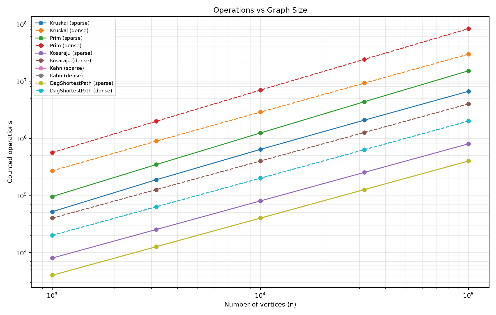
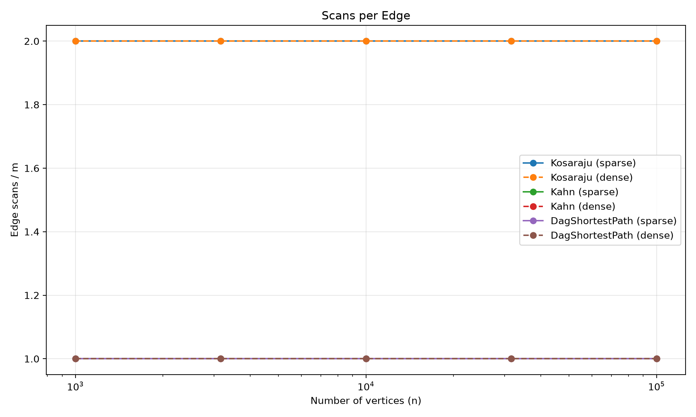
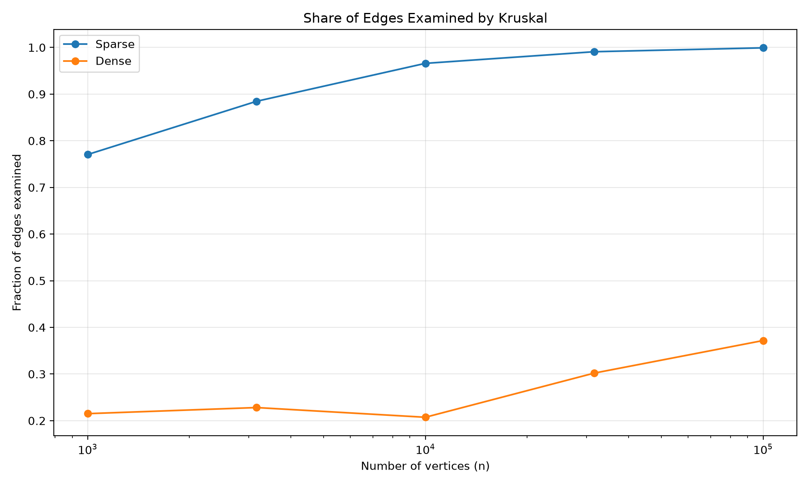

# DAA Assignment 3 — Graph Algorithms Report

**Student:** Zhumabay Akmaral   
**Group:** SE-2517  
**Course:** Design and Analysis of Algorithms  

## 1. Introduction

This assignment implements graph algorithms for a city network and job scheduler. The algorithms include Disjoint Set Union (DSU), Kruskal, Prim, Kosaraju, Kahn, and shortest paths in a Directed Acyclic Graph (DAG).

The project uses Java, adjacency lists, and operation counters to study correctness and efficiency. The benchmark uses five graph sizes from 1,000 to 100,000 vertices, with sparse (4n edges) and dense (20n edges) configurations. Every graph is generated with Random(42) for reproducibility.

All ten benchmark configurations matched the provided reference values.

## 2. Complexity Analysis

| Algorithm | Time Complexity | Extra Space | Explanation |
|---|---|---|---|
| DSU find/union | O(α(V)) amortized | O(V) | Path compression and union by size keep the trees shallow. |
| Kruskal | O(E log E) | O(V + E) | Sorting edges dominates; DSU checks connectivity. |
| Prim | O(V + E log E) | O(V + E) | A priority queue selects the cheapest available connection. |
| Kosaraju | O(V + E) | O(V + E) | Two DFS passes and a reversed graph. |
| Kahn | O(V + E) | O(V) | Calculates in-degrees and processes vertices using a queue. |
| DAG Shortest Paths | O(V + E) | O(V) | Topological ordering followed by one relaxation pass. |

Here, V represents vertices, E represents edges, and α(V) is the inverse Ackermann function.

## 3. Benchmark Results and Counters

The benchmark produced 50 rows, using the median execution time from five runs per algorithm and graph configuration. All reference MST weights, SCC counts, and DAG distance sums were reproduced.

The operation counters provide stronger complexity evidence than execution time.

| Algorithm | Measured Ratio | Observation |
|---|---|---|
| Kosaraju | edgeScans / E = 2 | Both DFS passes examine every edge once. |
| Kahn | edgeScans / E = 1 | Every edge is processed once. |
| DAG Shortest Paths | edgeScans / E = 1 | Every edge is relaxed once. |
| Prim | edgeScans / E = 2 | Each undirected edge appears in two adjacency lists. |
| Kruskal | dsuOps / E varies | DSU work depends on when the spanning tree becomes complete. |

For example, on the sparse graph with 1,000 vertices and 4,000 edges, Kruskal performed 9,161 DSU operations, giving a ratio of 2.290. On the sparse graph with 100,000 vertices and 400,000 edges, it performed 1,099,333 operations, giving approximately 2.748. These ratios remain within a small constant range.

Kruskal's sorting comparisons are also important because its overall complexity includes sorting even when edge scanning stops early.

## 4. Correctness Arguments

### Minimum Spanning Tree — Cut Property

The cut property states that a minimum-weight edge crossing a cut is safe to include in a minimum spanning tree. Kruskal sorts all edges by weight and considers them in increasing order. It uses DSU to avoid adding edges that would create cycles. When an edge connects two different components, it is a minimum-weight eligible edge across the cut separating those components. Prim follows the same property by repeatedly selecting the cheapest edge connecting the current tree to an unvisited vertex. Therefore, both algorithms construct minimum spanning trees, although their selected edges may differ when equal weights exist. The benchmark confirms that Kruskal and Prim produce identical total weights.

### DAG Shortest Paths — Induction on Topological Order

A topological order places every vertex before all vertices reachable through its outgoing edges. Initially, every vertex with in-degree zero has distance zero, representing a virtual super-source. Assume that the shortest distances of all previously processed vertices are correct. When the next vertex is processed, all its incoming predecessors have already been processed. Therefore, every possible incoming edge has already been considered, and its shortest distance is correct. Relaxing its outgoing edges propagates the correct candidate distances to later vertices. By induction, after processing the entire topological order, all shortest distances are correct. Negative edge weights are allowed because a DAG has no directed cycles and therefore cannot contain a negative cycle.

## 5. Choosing the Right Algorithm

| Situation | Recommended Algorithm | Reason |
|---|---|---|
| MST with an edge list | Kruskal | Sorting edges and using DSU is straightforward. |
| MST with adjacency lists | Prim | Efficiently grows the tree using a priority queue. |
| Disconnected undirected graph | Kruskal or Prim | Both return a minimum spanning forest. |
| Finding strongly connected groups | Kosaraju | Finds SCCs using two DFS passes. |
| Scheduling jobs without cycles | Kahn | Produces a valid topological execution order. |
| Detecting dependency cycles | Kahn | Detects when a complete topological order is impossible. |
| Shortest paths in a DAG | DAG Shortest Paths | Linear-time relaxation; supports negative weights. |
| General graph with negative weights | Bellman–Ford | Handles negative edges and detects reachable negative cycles. |

For dense graphs, Prim can be attractive, particularly with an appropriate priority-queue or matrix implementation. However, performance depends on the graph representation and implementation, so density alone does not guarantee that Prim is faster than Kruskal.

## 6. Log-Log Slope Analysis

The slopes were calculated by fitting a straight line to the logarithms of graph size and counted operations.

| Algorithm | Sparse Slope | Dense Slope |
|---|---:|---:|
| Kruskal | 1.052 | 1.020 |
| Prim | 1.101 | 1.085 |
| Kosaraju | 1.000 | 1.000 |
| Kahn | 1.000 | 1.000 |
| DAG Shortest Paths | 1.000 | 1.000 |

The traversal algorithms have slopes of exactly 1.000 because their edge scans increase proportionally to E. Kruskal and Prim show slightly larger slopes due to sorting and priority-queue comparisons. The observed slopes are close to linear over the tested range, but this does not change their theoretical logarithmic factors.

## 7. Benchmark Plots

### Plot 1 — Operations vs Graph Size

The log-log chart shows that operation counts increase as the graph grows. The traversal algorithms have approximately linear growth, while Kruskal and Prim perform additional comparison work.

### Plot 2 — Scans per Edge

Kosaraju consistently scans 2E edges, while Kahn and DAG shortest paths scan E edges each. The flat lines confirm the expected linear edge-traversal work.

### Plot 3 — Kruskal Edge Examination

Kruskal examines a larger fraction of edges in sparse graphs than in dense graphs. For the smallest sparse graph, it examined 3,082 out of 4,000 edges, approximately 77.1%. For the smallest dense graph, it examined 4,302 out of 20,000 edges, approximately 21.5%. This happens because Kruskal stops scanning after finding enough edges to connect all vertices. However, sorting still processes the full edge list.

## 8. Execution Time

Execution times generally increased with graph size and density. In the benchmark, the smallest algorithms completed in only a few milliseconds, while the largest configurations required substantially more time. However, wall-clock measurements depend on the CPU, JVM, memory management, JIT compilation, and background processes. Small measurements are especially sensitive to noise. For this reason, the analysis focuses on reproducible operation counters rather than using execution time alone to justify complexity.

## 9. Testing and Validation

The Maven project contains JUnit 5 tests for DSU, MST algorithms, Kosaraju, Kahn, and DAG shortest paths.

The test run completed successfully with 14 tests, zero failures, zero errors, and zero skipped tests. The benchmark independently verified the reference results across all ten configurations, including graphs with 100,000 vertices.

## 10. Conclusion

This assignment demonstrated how graph algorithms solve different network and scheduling problems. Kruskal and Prim found matching minimum spanning tree weights, Kosaraju identified strongly connected components, Kahn validated dependency orders, and DAG shortest paths calculated distances with support for negative weights.

The results confirmed the expected edge-scan behavior of the traversal algorithms. The benchmark also showed why operation counters are useful for comparing algorithms independently of hardware performance.